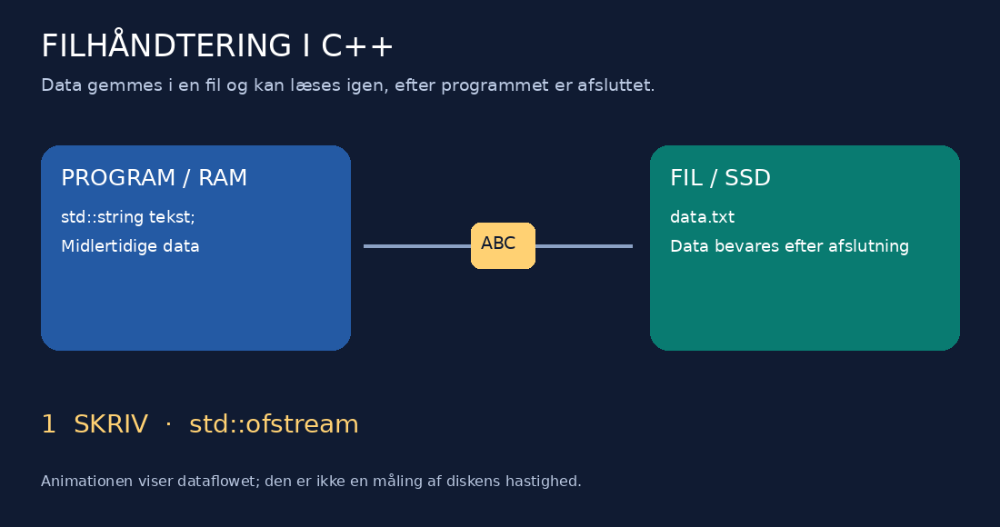
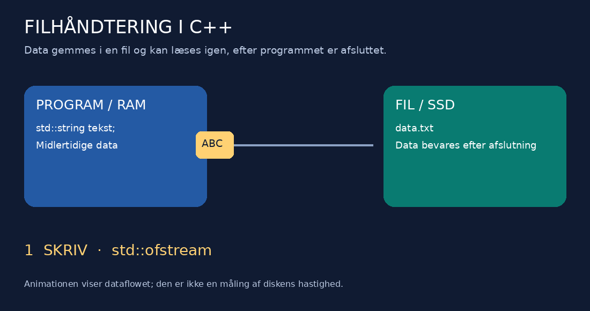

# 📂 Filhåndtering i C++

**Visuel undervisningsguide · teori, kode og øvelser**



> 🎯 **Læringsmål:** Du kan skrive tekst til en fil, læse teksten igen, vælge en åbningstilstand og kontrollere, om en filoperation lykkes.

## 1. Hvorfor gemmer vi data i filer?

Et program arbejder med variable i hukommelsen (RAM). Når programmet afsluttes, er dets variable ikke længere tilgængelige for programmet. Skal oplysningerne bruges ved næste kørsel, skal de gemmes.

En fil på SSD eller harddisk kan bevare data efter programmets afslutning. Det kan være en tekst, en klasseliste eller resultatet af en beregning.

| 🔵 RAM | 🟢 Fil på disk |
|---|---|
| Programmets arbejdsområde | Lagring mellem kørsler |
| Variable og objekter under kørsel | Eksempelvis `data.txt` eller `rapport.csv` |
| Skal gemmes, hvis data skal bruges senere | Kan åbnes igen af et nyt program |

To almindelige måder at gemme data på er **filer** og **databaser**. MySQL og SQLite er databasesystemer; SQL er et sprog, der bruges til at arbejde med relationelle databaser. Her fokuserer vi på filer.

## 2. Se data bevæge sig



1. **Skriv:** Programmet sender tekst til en fil via en filstrøm.
2. **Afslut:** Programmet stopper, men den gemte fil bliver liggende.
3. **Læs:** Et program åbner filen og læser teksten ind i en variabel.

*Animationen er en forklaringsmodel. Den viser ikke buffering eller den faktiske diskhastighed.*

## 3. Tre klasser fra `<fstream>`

```cpp
#include <fstream>
```

| Klasse | Anvendelse | Huskeregel |
|---|---|---|
| `std::ofstream` | Skriv til en fil | **o** = output fra programmet |
| `std::ifstream` | Læs fra en fil | **i** = input til programmet |
| `std::fstream` | Både læsning og skrivning | En filstrøm til begge retninger |

Filstrømmene er objekter. Konstruktoren kan åbne filen, og destruktoren lukker den automatisk, når objektet forlader sit scope. Du kan også bruge `close()` eksplicit.

## 4. Vælg den rigtige åbningstilstand

| Tilstand | Betydning | Vær opmærksom på |
|---|---|---|
| `std::ios::in` | Åbn til læsning | En almindelig inputåbning fejler, hvis filen ikke findes |
| `std::ios::out` | Åbn til skrivning | En almindelig outputåbning opretter en manglende fil og tømmer en eksisterende fil |
| `std::ios::app` | Tilføj i slutningen ved hver skrivning | Eksisterende indhold bevares |
| `std::ios::binary` | Åbn i binær tilstand | Konverterer ikke automatisk objekter til et filformat |
| `std::ios::trunc` | Tøm filen ved åbning | Tidligere indhold slettes |

Tilstande kan kombineres med `|`:

```cpp
std::fstream fil("data.txt", std::ios::out | std::ios::app);
```

> 🟠 **Vigtigt:** `std::ofstream fil("data.txt");` overskriver som standard eksisterende indhold. Brug `std::ios::app`, når tidligere tekst skal bevares. Adfærden afhænger af den samlede kombination af tilstande.

## 5. Eksempel: Skriv fast tekst til en fil

Dette eksempel svarer til PDF'ens eksempel med hardkodet tekst. Koden er omskrevet til kopierbar kode med kontrol af både åbning og skrivning.

```cpp
#include <fstream>
#include <iostream>

int main() {
    std::ofstream fil("data.txt", std::ios::app);

    if (!fil) {
        std::cerr << "Kunne ikke aabne data.txt.\n";
        return 1;
    }

    fil << "Linje 1\n";
    fil << "Linje 2\n";
    fil << "Linje 3\n";
    fil.close();

    if (!fil) {
        std::cerr << "Kunne ikke gemme alle data.\n";
        return 1;
    }

    std::cout << "Teksten er gemt.\n";
}
```

### Hvad sker der trin for trin?

1. Konstruktoren åbner `data.txt` til tilføjelse.
2. `if (!fil)` undersøger, om åbningen fejlede.
3. `<<` sender tekst til filstrømmen; `\n` laver et linjeskift.
4. `close()` afslutter skrivningen og lukker filen.
5. Den sidste kontrol opdager fejl registreret under skrivning eller lukning.

Efter første kørsel indeholder en ny fil:

```text
Linje 1
Linje 2
Linje 3
```

Kører du programmet igen, tilføjes de samme tre linjer, fordi vi bruger `app`.

## 6. Eksempel: Gem tekst fra tastaturet

Her bestemmer brugeren indholdet under kørsel. `std::getline()` læser en hel linje inklusive mellemrum.

```cpp
#include <fstream>
#include <iostream>
#include <string>

int main() {
    std::string tekst;
    std::cout << "Skriv en tekst: ";

    if (!std::getline(std::cin, tekst)) {
        std::cerr << "Kunne ikke laese input.\n";
        return 1;
    }

    std::ofstream fil("data.txt", std::ios::app);
    if (!fil) {
        std::cerr << "Kunne ikke aabne filen.\n";
        return 1;
    }

    fil << tekst << '\n';
    fil.close();

    if (!fil) {
        std::cerr << "Skrivningen mislykkedes.\n";
        return 1;
    }

    std::cout << "Din tekst er gemt.\n";
}
```

| Trin | Data |
|---|---|
| Tastatur | Brugeren skriver `Hej fra klassen` |
| RAM | Variablen `tekst` indeholder teksten |
| Fil | Teksten tilføjes til `data.txt` |
| Næste kørsel | Filen indeholder stadig den gemte tekst |

## 7. Ekstra eksempel: Læs filen igen

```cpp
#include <fstream>
#include <iostream>
#include <string>

int main() {
    std::ifstream fil("data.txt");
    if (!fil) {
        std::cerr << "Kunne ikke aabne data.txt.\n";
        return 1;
    }

    std::string linje;
    while (std::getline(fil, linje)) {
        std::cout << linje << '\n';
    }

    if (fil.bad() || (fil.fail() && !fil.eof())) {
        std::cerr << "Der opstod en laesefejl.\n";
        return 1;
    }
}
```

Løkken forsøger at læse en linje og fortsætter kun, hvis læsningen lykkes. At nå slutningen af filen er normalt. Brug ikke `while (!fil.eof())`: slutningen opdages først efter et læseforsøg.

## 8. Hvor ligger filen?

`"data.txt"` er en relativ sti. Filen placeres i programmets **aktuelle arbejdsmappe**, som ikke nødvendigvis er den samme mappe som kildekoden.

Du kan vise arbejdsstien med C++17:

```cpp
#include <filesystem>
#include <iostream>

int main() {
    std::cout << std::filesystem::current_path() << '\n';
}
```

En absolut Windows-sti kan skrives som en raw string:

```cpp
std::ofstream fil(R"(C:\Files\data.txt)", std::ios::app);
```

Mappen `C:\Files` skal allerede eksistere. Filstrømmen opretter ikke manglende mapper.

## 9. Fejlhåndtering og gode vaner

- Kontrollér åbningen, før du læser eller skriver.
- Kontrollér resultatet af skrivningen, før du fortæller brugeren, at data er gemt.
- Vælg bevidst mellem overskrivning og tilføjelse.
- Gem tekst i en aftalt encoding, når filer skal deles mellem programmer.
- En filendelse som `.dat` bestemmer ikke i sig selv, om indholdet er tekst eller binært.

> 🔎 **Om PDF'ens `try`/`catch`:** Filstrømme kaster normalt ikke exceptions ved almindelige filfejl. De sætter fejlflag. Eksemplerne her kontrollerer derfor strømmenes tilstand. Exceptions kan aktiveres med `exceptions()`, men det er ikke nødvendigt i disse begynderøvelser.

## 10. Øvelser

### 🟢 A · Første fil

1. Opret et C++ Console App-projekt.
2. Gem dit navn og din klasse i `elev.txt`.
3. Åbn filen i en teksteditor og kontrollér indholdet.

### 🔵 B · Tilføj eller overskriv?

1. Kør skriveprogrammet to gange med `std::ios::app`.
2. Notér antallet af linjer efter hver kørsel.
3. Fjern `app`, og gentag forsøget med en testfil.
4. Forklar forskellen med dine egne ord.

### 🟣 C · Tastatur og læsning

1. Bed brugeren om en hel sætning og gem den.
2. Luk programmet.
3. Start læseprogrammet, og vis den gemte tekst.
4. Test også en tom linje og en fil, der ikke findes.

### 🟠 D · Udvid Kindergarten-opgaven

Tilføj en public metode til `Kindergarten`:

```cpp
bool saveReport(const std::string& filename) const;
```

Metoden skal gemme antal børn, frugt pr. barn, rester, pris pr. frugttype og samlet pris. Brug klassens eksisterende beregningsmetoder. Returnér `true`, når rapporten er gemt, og `false` ved en filfejl.

**Kontrol:** Med 32 børn, 45 æbler, 49 pærer og 65 bananer skal rapportens samlede pris være **68 kr**.

Læs hele opgaven i [Kindergarten_OOP_CPP.md](Kindergarten_OOP_CPP.md).

## 11. Refleksion

- Hvorfor er en variabel ikke nok til at gemme oplysninger mellem kørsler?
- Hvad er forskellen på `ifstream` og `ofstream`?
- Hvornår skal du bruge `app`?
- Hvorfor er en vellykket åbning ikke en garanti for en vellykket skrivning?
- Hvordan hænger filstrømme sammen med klasser, objekter og destruktorer?

---

*Bearbejdet fra det vedlagte materiale “Filhåndtering i C++”. Kodebillederne er omskrevet, sproget er rettet, og der er tilføjet animation, læsning, fejlkontrol og øvelser.*
