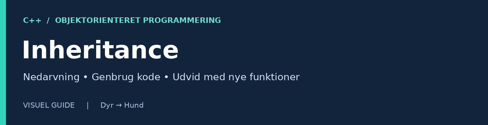
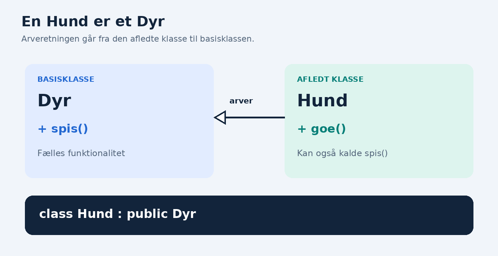
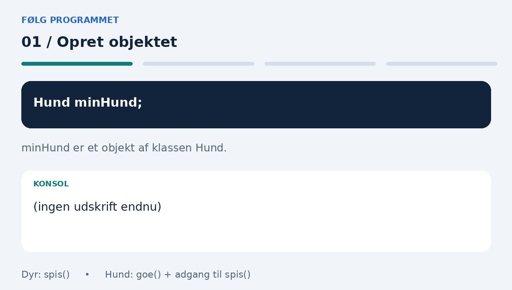

# Inheritance i C++



> **Læringsmål:** Forstå basisklasser og afledte klasser, læs `public` nedarvning, og brug en arvet funktion i et C++-program.

**Niveau:** Begynder · **Eksempel:** Dyr og Hund · **Sprog:** C++

---

## 1. Hvad er nedarvning?

**Inheritance betyder nedarvning** i objektorienteret programmering. Det betyder, at du kan lave en ny klasse, som bygger videre på en eksisterende klasse.

Den nye klasse kan genbruge funktionalitet og tilføje sine egne egenskaber og funktioner.

## 2. Et enkelt eksempel: Dyr og Hund

Tænk på en generel klasse, der hedder `Dyr`. Et dyr kan fx spise. En `Hund` er et dyr, så den kan også spise, men den kan desuden gø.



*Den hule trekant peger mod basisklassen `Dyr`. Blå viser det fælles; grøn viser det, `Hund` tilføjer. Plusset angiver en public funktion.*

| Begreb | Betydning | Eksempel |
| --- | --- | --- |
| **Basisklasse** (*Base class*) | Klassen, som andre klasser arver fra | `Dyr` |
| **Afledt klasse** (*Derived class*) | Klassen, som arver og bygger videre | `Hund` |

> **Huskeregel:** Basisklassen indeholder det fælles. Den afledte klasse bygger videre med det særlige.

## 3. Se programmet som en animation



Animationen gentages automatisk. Her er de samme trin som tekst:

| Trin | Kode | Hvad sker der? |
| --- | --- | --- |
| 1 | `Hund minHund;` | Opretter et objekt af klassen `Hund`. |
| 2 | `minHund.spis();` | Bruger funktionen fra `Dyr` og udskriver `Dyret spiser.` |
| 3 | `minHund.goe();` | Bruger funktionen fra `Hund` og udskriver `Hunden siger vov!` |
| 4 | Begge kald er udført | Samme objekt har brugt både den arvede og sin egen funktion. |

## 4. Sådan skriver vi det i C++

```cpp
#include <iostream>
using namespace std;

// Basisklasse
class Dyr {
public:
    void spis() {
        cout << "Dyret spiser." << endl;
    }
};

// Hund arver fra Dyr
class Hund : public Dyr {
public:
    void goe() {
        cout << "Hunden siger vov!" << endl;
    }
};

int main() {
    Hund minHund;

    minHund.spis(); // Funktion fra Dyr
    minHund.goe();  // Funktion fra Hund

    return 0;
}
```

### Den vigtigste linje

```cpp
class Hund : public Dyr
```

| Del | Betydning |
| --- | --- |
| `class Hund` | Vi definerer klassen `Hund`. |
| `:` | Klassen arver fra den efterfølgende basisklasse. |
| `public Dyr` | `Hund` arver offentligt fra `Dyr`. De offentlige medlemmer i `Dyr` forbliver offentlige i `Hund`. |

### Programmet udskriver

```text
Dyret spiser.
Hunden siger vov!
```

## 5. Hvad betyder “IS-A”?

“IS-A” betyder **“er en”** og beskriver forholdet mellem klasserne:

| Relation | Eksempel | Passende opbygning |
| --- | --- | --- |
| **Er en / IS-A** | En hund **er et** dyr. | Nedarvning passer. |
| **Er en / IS-A** | En bil **er et** køretøj. | Nedarvning passer. |
| **Har en / HAS-A** | En bil **har en** motor. | Motoren bør normalt være et objekt inde i bilen. Dette kaldes komposition. |

## 6. Vigtigt om adgang

En vigtig detalje i C++: Den afledte klasse kan ikke tilgå basisklassens `private` medlemmer direkte. Den kan bruge de tilgængelige funktioner, som basisklassen stiller til rådighed.

> **Eksempel:** Hvis `Dyr` har en privat variabel, kan `Hund` ikke læse den direkte. En tilgængelig funktion i `Dyr` kan give kontrolleret adgang til værdien.

## 7. Prøv selv

1. Opret en klasse `Kat`, som arver fra `Dyr` med `public` nedarvning.
2. Tilføj funktionen `miav()`, som udskriver `Katten siger miav!`.
3. Opret objektet `minKat`, og kald både `spis()` og `miav()`.
4. Forklar, hvorfor du ikke behøver skrive `spis()` igen i `Kat`.

---

**Brug af dokumentet:** Bevar mappen `assets/inheritance` ved siden af denne Markdown-fil. Billeder og GIF-animation vises i Markdown-læsere, der understøtter disse formater, fx GitHub. Farverne ligger i illustrationerne; kodefarver afhænger af læserens tema. Ved PDF-udskrift bliver animationen normalt til et stillbillede.
