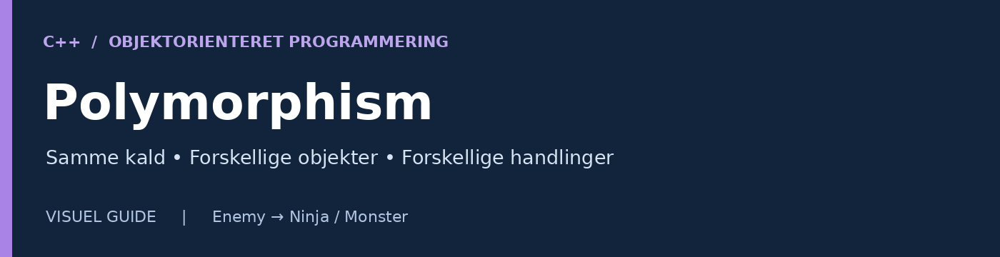
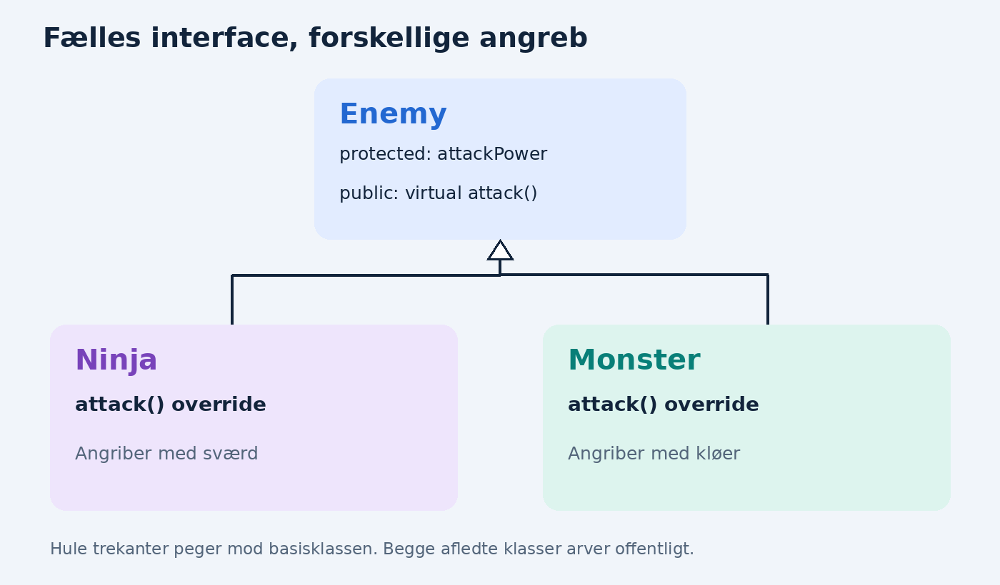
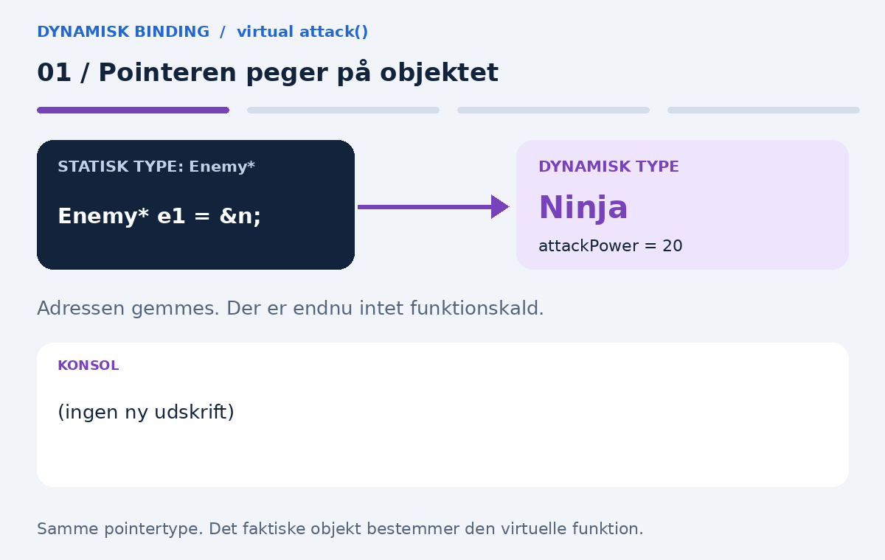

# Polymorphism i C++: Use Case



> **Læringsmål:** Forstå baseklassepointere, `virtual`, `override` og dynamisk binding gennem et enkelt spileksempel.

**Niveau:** Begynder · **Forudsætning:** Klasser, objekter og nedarvning · **Eksempel:** Enemy, Ninja og Monster

---

## Polymorfi betyder “mange former”

I C++ betyder det blandt andet, at vi kan kalde den samme funktion på forskellige typer objekter, og at objekterne reagerer forskelligt.

I dette spil bruges følgende eksempel:

- En **Ninja** er en fjende.
- Et **Monster** er også en fjende.
- Begge kan angribe med `attack()`, men de har **hver deres måde at angribe på**.

Guiden fokuserer på **dynamisk polymorfi**. Lad os gennemgå koden trin for trin.



*De hule trekanter peger mod basisklassen. Blå er det fælles interface; lilla og grøn er de to afledte klassers implementeringer.*

## 1. Enemy er baseklassen

Baseklassen indeholder det, som alle fjender har til fælles. Vi begynder med den enkle version fra PDF’en, som endnu ikke har `attack()`:

```cpp
class Enemy {
protected:
    int attackPower;

public:
    void setAttackPower(int a) {
        attackPower = a;
    }
};
```

| Del af koden | Betydning |
| --- | --- |
| `class Enemy` | Definerer en klasse for fjender. |
| `attackPower` | Gemmer fjendens angrebsstyrke. |
| `protected` | Klassen selv og dens afledte klasser kan bruge variablen direkte på deres egne objekter. |
| `public` | Funktionerne kan kaldes fra kode uden for klassen. |
| `setAttackPower(int a)` | Sætter fjendens angrebsstyrke til værdien `a`. |

For eksempel giver `n.setAttackPower(20);` variablen `attackPower` værdien `20` i objektet `n`.

> **Bemærk:** I denne første version skal styrken sættes, før den læses. Det komplette eksempel nedenfor initialiserer den til `0` i constructoren.

## 2. Ninja og Monster arver fra Enemy

```cpp
class Ninja : public Enemy {
public:
    void attack() {
        cout << "Ninja! - " << attackPower << endl;
    }
};

class Monster : public Enemy {
public:
    void attack() {
        cout << "Monster! - " << attackPower << endl;
    }
};
```

Linjen `class Ninja : public Enemy` betyder, at `Ninja` arver fra `Enemy`. **En Ninja er en slags Enemy.**

Begge klasser får adgang til `attackPower` og arver funktionen `setAttackPower()`. De definerer hver deres `attack()`:

```cpp
Ninja n;
Monster m;

n.setAttackPower(20);
m.setAttackPower(80);

n.attack();
m.attack();
```

Resultat:

```text
Ninja! - 20
Monster! - 80
```

**Hvert objekt har sin egen angrebsstyrke.** Når vi ændrer Ninjaens styrke, ændrer vi ikke Monsterets.

*Disse første kodeblokke er uddrag. De bruger `cout` og `endl` fra `<iostream>` med `using namespace std;`, som vist i det komplette program.*

## 3. Hvad betyder Enemy* e1 = &n;?

```cpp
Ninja n;
Monster m;

Enemy* e1 = &n;
Enemy* e2 = &m;
```

Læs den første pointer sådan:

> `e1` er en pointer af typen `Enemy*`, som peger på Ninja-objektet `n`.

| Symbol | Betydning |
| --- | --- |
| `Enemy*` | En pointer til `Enemy`, som også kan pege på basedelen af et objekt fra en offentligt afledt klasse. |
| `&n` | Adressen på objektet `n`. |
| `e1` | Variablen, der gemmer adressen. |

Det er tilladt, fordi **en Ninja også er en Enemy**. Pointeren laver ikke en kopi af Ninjaen. Den peger på det eksisterende objekt.

Derfor ændrer `e1->setAttackPower(20);` angrebsstyrken i `n`. Disse to linjer har samme effekt:

```cpp
n.setAttackPower(20);     // Adgang direkte gennem objektet
e1->setAttackPower(20);  // Adgang gennem pointeren
```

Vi bruger **`.` med et objekt** og **`->` med en pointer**.

## 4. Fra nedarvning til dynamisk polymorfi

De første eksempler kalder `n.attack();` og `m.attack();` direkte. Her vælger vi Ninjaens og Monsterets funktioner via objekternes kendte typer.

Hvis vi med den første `Enemy`-klasse prøver:

```cpp
// Kan ikke kompileres med den første Enemy-klasse:
e1->attack();
```

får vi en kompileringsfejl, fordi `Enemy` **ikke har nogen `attack()`-funktion**.

For at kalde `attack()` gennem en `Enemy*` og få det faktiske objekts version skal baseklassen deklarere en **virtuel funktion**:

```cpp
virtual void attack();
```

Denne linje viser deklarationen. Det komplette program nedenfor giver også funktionen en implementation.

| Situation | Resultat ved `e1->attack()`, hvor e1 peger på Ninja |
| --- | --- |
| Ingen `attack()` i `Enemy` | Kompileringsfejl. |
| En ikke-virtuel `attack()` i `Enemy` | `Enemy::attack()` kaldes. |
| En virtuel `attack()` i `Enemy`, overridet i `Ninja` | `Ninja::attack()` kaldes. |

> **Husk:** Nedarvning giver fælles struktur. `virtual` muliggør valg af den afledte implementation gennem en baseklassepointer eller -reference.

## 5. Se dynamisk binding som animation



Animationen gentages automatisk. De samme trin står her som tekst:

| Trin | Pointer og objekt | Virtuelt kald | Valgt funktion |
| --- | --- | --- | --- |
| 1 | `Enemy* e1 = &n;` | Intet kald endnu | Pointeren peger på Ninja. |
| 2 | `e1` peger på `n` | `e1->attack();` | `Ninja::attack()` |
| 3 | `Enemy* e2 = &m;` | Intet kald endnu | Pointeren peger på Monster. |
| 4 | `e2` peger på `m` | `e2->attack();` | `Monster::attack()` |

Begge pointere har **statisk type `Enemy*`**. De faktiske objekter har forskellig **dynamisk type**: `Ninja` og `Monster`.

## 6. Komplet eksempel med dynamisk polymorfi

[Download C++-koden](examples/polymorphism/enemies.cpp).

```cpp
#include <iostream>
using namespace std;

class Enemy {
protected:
    int attackPower;
public:
    // Alle fjender starter med angrebsstyrke 0.
    Enemy() : attackPower(0) {}

    void setAttackPower(int power) {
        attackPower = power;
    }

    // Det faktiske objekt bestemmer versionen ved virtuelle kald.
    virtual void attack() {
        cout << "Enemy angriber med styrke " << attackPower << endl;
    }

    // Muliggør korrekt destruktion gennem en Enemy-pointer.
    virtual ~Enemy() = default;
};

class Ninja : public Enemy {
public:
    // Compileren kontrollerer, at en virtuel funktion overrides.
    void attack() override {
        cout << "Ninja angriber med et svaerd! Styrke: "
             << attackPower << endl;
    }
};

class Monster : public Enemy {
public:
    void attack() override {
        cout << "Monster angriber med kloer! Styrke: "
             << attackPower << endl;
    }
};

int main() {
    Ninja n;
    Monster m;

    Enemy* e1 = &n;
    Enemy* e2 = &m;

    e1->setAttackPower(20);
    e2->setAttackPower(80);

    // Samme pointertype, men forskellige implementeringer.
    e1->attack();
    e2->attack();
    return 0;
}
```

### Output

```text
Ninja angriber med et svaerd! Styrke: 20
Monster angriber med kloer! Styrke: 80
```

| Kald | Pointerens type | Faktisk objekt | Funktionen, der køres |
| --- | --- | --- | --- |
| `e1->attack()` | `Enemy*` | `Ninja` | `Ninja::attack()` |
| `e2->attack()` | `Enemy*` | `Monster` | `Monster::attack()` |

**`virtual` betyder her: “Brug funktionen fra det objekt, pointeren faktisk peger på.”** Valget følger objektets dynamiske type, mens programmet kører. Det kaldes **dynamisk binding**.

### De vigtigste nøgleord

| Kode | Hvorfor er den med? |
| --- | --- |
| `Enemy() : attackPower(0)` | Constructoren initialiserer angrebsstyrken til `0`. |
| `virtual void attack()` | Gør funktionskaldet polymorft. |
| `void attack() override` | Beder compileren kontrollere, at funktionen faktisk overrider en virtuel funktion i baseklassen. |
| `virtual ~Enemy() = default;` | Sikrer korrekt destruktion, hvis et afledt objekt slettes gennem en `Enemy*`. |

Objekterne `n` og `m` er lokale i dette eksempel. Pointerne ejer dem ikke, og vi skal **ikke** kalde `delete` på `e1` eller `e2`.

### Kør programmet

Med en installeret GCC-compiler kan du køre følgende fra repositoryets rod på Linux eller macOS:

```bash
g++ -std=c++17 -Wall -Wextra -pedantic examples/polymorphism/enemies.cpp -o enemies
./enemies
```

På Windows med Visual Studio: opret et C++ Console App-projekt, indsæt koden i projektets `.cpp`-fil, og kør med **Ctrl+F5**.

## 7. Hvorfor er det nyttigt i et spil?

Du kan behandle forskellige fjender samlet. Erstat de to direkte pointerkald i `main()` med:

```cpp
Enemy* enemies[] = { &n, &m };

for (Enemy* enemy : enemies) {
    enemy->attack();
}
```

Løkken behøver ikke undersøge, om fjenden er en Ninja eller et Monster. Den siger bare:

> **“Fjende, angrib!”**

Hvert objekt udfører sin egen version af `attack()`. Det er fordelen ved dynamisk polymorfi. Løkken giver samme output som de to kald i det komplette program.

## 8. Prøv selv: Tilføj en Dragon

1. Opret `class Dragon : public Enemy`.
2. Skriv `void attack() override`, som udskriver, at dragen angriber med ild, og viser dens styrke.
3. Opret `Dragon d;`, og sæt dens styrke til `100`.
4. Tilføj `&d` til arrayet `enemies`.
5. Kør den samme løkke igen. Du skal nu få tre forskellige angreb.

**Refleksion:** Hvorfor kan løkkens indhold være uændret, selvom du tilføjer en ny slags fjende?

---

**Materiale:** Bearbejdet fra den vedhæftede PDF *Polymorphism i C++: Use Case*, med nye diagrammer, animation, nøgleordsforklaring og øvelse. De tomme PDF-sider er udeladt.

**Visning:** Bevar `assets/polymorphism` og `examples/polymorphism` sammen med Markdown-filen. GIF-animationen virker i fx GitHub; ved PDF-udskrift bliver den normalt et stillbillede. Kodefarver afhænger af Markdown-læserens tema.
