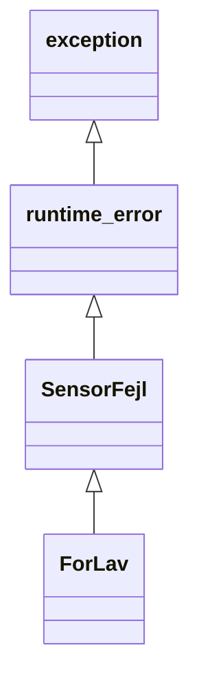

# Program 11 · Exceptions, noexcept og sikker oprydning

[Oversigt](OOP_Laeringsforloeb.md) · [Forrige](Program_10_Operatoroverloading.md) · [Interaktivt lab](interactive/oop-videre.html)

## try, throw og catch

En funktion kan opdage en fejl, som den ikke selv kan løse. En exception kan sende informationen op til et sted, der har mulighed for at håndtere den.

```cpp
try {
    // Kode, som kan fejle.
    throw std::runtime_error("Kunne ikke læse målingen");
}
catch (const std::exception& e) {
    std::cout << e.what() << '\n';
}
```

`try` afgrænser den kode, vi vil håndtere fejl fra. `throw` starter exception-håndtering og afbryder den normale vej gennem funktionen. `catch` matcher en exception-type. Når en passende handler er afsluttet, fortsætter programmet efter hele try/catch-konstruktionen. Det hopper ikke tilbage og prøver den fejlede linje igen, medmindre vi selv programmerer en gentagelse.

Exceptions bør beskrive fejl, der bryder operationens normale forventning. En almindelig løkke eller et forventet menupunkt bør normalt ikke styres med exceptions. Ikke alle fejl bliver automatisk exceptions: eksempelvis er undefined behavior ikke en sikker fejlhåndteringsmekanisme.

## Exceptions og afledte klasser

Exception-typer kan danne et hierarki. `ForLav` kan være en særlig `SensorFejl`, som igen er en `std::runtime_error` og dermed en `std::exception`.



Catches undersøges i den rækkefølge, de står. Skriv den specifikke derived-type først og den generelle base-type bagefter. Ellers kan den generelle handler fange fejl, som du egentlig ville behandle mere præcist. Arven skal være offentlig og entydig for denne matching via en base.

Fang normalt med `const Type&`. Det undgår en unødig kopi og bevarer den afledte exception-type. Fangst som en base-værdi kan slice objektet. `catch (...)` kan fange enhver exception-type, men giver dig ikke i sig selv en navngivet exception, du kan spørge om `what()`.

## RAII: ejerskab styrer oprydning

RAII står for **Resource Acquisition Is Initialization**. En ressource bindes til et ejerobjekts levetid. Constructoren etablerer ejerskabet, og destructoren frigiver ressourcen. En ressource kan være hukommelse, en fil eller en lås.

| Ressource | Typisk C++-ejer | Automatisk oprydning |
| --- | --- | --- |
| Dynamisk allokeret objekt | `std::unique_ptr<T>` | Sletter det ejede objekt |
| Samling med dynamisk lager | `std::vector<T>` | Destruerer elementer og frigiver lager |
| Åben fil | `std::ifstream` / `std::ofstream` | Lukker filen |
| Låst mutex | `std::lock_guard<std::mutex>` | Låser mutexen op |

Resource capture handler her om at overtage ejerskabet af ressourcen. Det er ikke det samme som en lambdas capture-liste.

Når en exception bevæger sig mod en passende handler, destrueres fuldt konstruerede automatiske objekter i de scopes, der forlades. Det kaldes **stack unwinding**. RAII gør derfor oprydningen uafhængig af, om den normale returnering lykkes.

En rå pointer er ikke i sig selv en ejer. Hvis vi skriver `T* p = new T;` og forlader scopet gennem en exception før `delete p`, opstår der let en læk. Brug i almindelig kode `auto p = std::make_unique<T>();`, så ejerskabet er eksplicit.

## Se unwind-rækkefølgen

Programmet her bruger en `Vagt`, der kun logger livscyklussen. Den åbner ikke rigtige filer eller låse. Det gør rækkefølgen let at se uden at kræve eksterne ressourcer.

[09_exceptions_raii.cpp](examples/oop-advanced/09_exceptions_raii.cpp):

```cpp
#include <iostream>
#include <stdexcept>
#include <string>
class SensorFejl : public std::runtime_error {
public:
    using std::runtime_error::runtime_error;
};
class ForLav : public SensorFejl {
public:
    using SensorFejl::SensorFejl;
};
class Vagt { // Simulerer en ejet ressource uden at åbne rigtige filer.
    std::string navn;
public:
    explicit Vagt(std::string n) : navn(n) { std::cout << "Hent " << navn << '\n'; }
    ~Vagt() noexcept { std::cout << "Frigiv " << navn << '\n'; }
    Vagt(const Vagt&) = delete;
    Vagt& operator=(const Vagt&) = delete;
};
void maal(int v) {
    Vagt laas("laas"), fil("fil");
    if (v < 0) throw ForLav("Negativ maaling");
    std::cout << "Maaling: " << v << '\n';
}
int main() {
    try { maal(-1); }
    catch (const ForLav& e) { std::cout << "Specifik catch: " << e.what() << '\n'; }
    catch (const SensorFejl& e) { std::cout << "Sensorfejl: " << e.what() << '\n'; }
    catch (const std::exception& e) { std::cout << "Standardfejl: " << e.what() << '\n'; }
    std::cout << "Fortsætter\n";
}
```

Output:

```text
Hent laas
Hent fil
Frigiv fil
Frigiv laas
Specifik catch: Negativ maaling
Fortsætter
```

Filen oprettes sidst og ryddes op først. Oprydningen sker, før den ydre catch kører. Normal kode efter `throw` i `maal()` bliver ikke udført. Sporingsprogrammet bruger standard-streams med deres normale exception-indstillinger; en produktions-destructor bør ikke være afhængig af logging, der kan kaste.

Et eksempel på en faktisk RAII-ejer er:

```cpp
// Uddrag; kræver <fstream> og <stdexcept>.
std::ifstream fil("data.txt");
if (!fil) throw std::runtime_error("Filen kunne ikke åbnes");
// Hvis senere kode kaster, lukker fil-objektets destructor filen.
```

Stream-fejl er som udgangspunkt ofte tilstandsflag, ikke exceptions. Derfor kontrollerer koden `!fil` og kaster selv. Når data skrives, kan en eksplicit afsluttende kontrol være nødvendig for at opdage skrive- eller lukkefejl; en destructor bør ikke være eneste sted, hvor vigtige fejl kan rapporteres.

## Genkast og fejl under håndtering

Hvis en handler logger og derefter vil lade et ydre lag håndtere den samme exception, bruges `throw;` uden operand:

[10_genkast.cpp](examples/oop-advanced/10_genkast.cpp):

```cpp
#include <iostream>
#include <stdexcept>
void nederst() { throw std::out_of_range("Indeks 8 findes ikke"); }
void mellem() {
    try { nederst(); }
    catch (const std::exception&) {
        std::cout << "Log i mellem\n";
        throw; // Bevar den oprindelige exception og dens dynamiske type.
    }
}
int main() {
    try { mellem(); }
    catch (const std::out_of_range& e) { std::cout << "Yderst: " << e.what() << '\n'; }
}
```

`throw;` bevarer den aktuelle exception. `throw e;` opretter derimod en ny exception ud fra udtrykket `e` og kan slice, hvis `e` har en base-type. `throw;` må kun bruges, når der er en exception under håndtering; ellers kaldes `std::terminate`.

En ny exception, der kastes inde i en catch, kan godt håndteres af en ydre try/catch. Den bliver ikke fanget af en anden catch til samme try. Brug et indre try/catch, hvis selve loggingen eller håndteringen kan fejle og skal håndteres på stedet.

Et farligere tilfælde opstår, hvis en destructor kaldes under stack unwinding og lader endnu en exception slippe ud. Så kaldes `std::terminate`. Lad derfor ikke oprydningskode kaste under sådan afvikling. Fang eventuelle interne oprydningsfejl, eller brug en særskilt eksplicit afslutningsfunktion til fejl, som kalderen skal kunne reagere på.

## Når en constructor fejler

[11_constructor_fejl.cpp](examples/oop-advanced/11_constructor_fejl.cpp):

```cpp
#include <iostream>
#include <stdexcept>
struct Del {
    Del() { std::cout << "+ Del\n"; }
    ~Del() { std::cout << "- Del\n"; }
};
struct Helhed {
    Del del;
    Helhed() {
        std::cout << "Helhed-krop starter\n";
        throw std::runtime_error("Kunne ikke starte");
    }
    ~Helhed() { std::cout << "- Helhed\n"; }
};
int main() {
    try { Helhed h; }
    catch (const std::exception& e) { std::cout << "Catch: " << e.what() << '\n'; }
} // ~Helhed bliver ikke kaldt; det fuldt oprettede medlem Del ryddes op.
```

Output:

```text
+ Del
Helhed-krop starter
- Del
Catch: Kunne ikke starte
```

`Del` blev færdigoprettet og destrueres. `Helhed` blev ikke færdigoprettet, så `~Helhed()` bliver ikke kaldt. Det er endnu en grund til at gemme ressourcer i medlemmer med egne destructors i stedet for at forvente, at den yderste destructor altid rydder op efter en mislykket constructor.

## Function exception declaration i moderne C++

I C++17 bruger vi exception specifications til at udtrykke, om en exception må forlade en funktion:

| Erklæring | Betydning for en almindelig funktion |
| --- | --- |
| `void f();` | Kan normalt lade exceptions slippe ud |
| `void f() noexcept;` | Ingen exception må slippe ud |
| `void f() noexcept(false);` | Exceptions må slippe ud |
| `void f() noexcept(udtryk);` | Betinget specification ud fra et konstant bool-udtryk |

Der er særlige regler for blandt andet destructors og visse automatisk genererede specialfunktioner. Tabellen skal ikke læses som om enhver funktion uden skrevet `noexcept` altid er potentielt kastende.

`noexcept` betyder ikke, at funktionen umuligt kan indeholde `throw`. Den kan håndtere en exception internt. Det afgørende er, om en exception **slipper ud**. Hvis den forlader en `noexcept`-funktion, kaldes `std::terminate`; en almindelig ydre catch kan ikke redde situationen. Standardhandleren afslutter normalt programmet via `abort`.

[12_noexcept.cpp](examples/oop-advanced/12_noexcept.cpp):

```cpp
#include <iostream>
int hent() noexcept { return 7; }
void kanFejle() noexcept(false) { /* Kan tillade exceptions at forlade funktionen. */ }
int main() {
    std::cout << std::boolalpha;
    std::cout << "hent: " << noexcept(hent()) << '\n';
    std::cout << "kanFejle: " << noexcept(kanFejle()) << '\n';
} // noexcept(udtryk) undersøger egenskaben uden at udføre udtrykket.
```

Her er der to anvendelser af samme ord. `noexcept` i erklæringen er en specification. `noexcept(hent())` i udtrykket er en compile-time undersøgelse, der giver `true` uden at kalde `hent()`.

### Ældre syntaks og unexpected exceptions

Du kan møde dette i ældre undervisningsmateriale:

```cpp
// Historisk syntaks, ikke gyldig standard-C++17:
// void f() throw(SensorFejl);
```

Lister af tilladte exception-typer blev deprecated i C++11 og fjernet i C++17. Den gamle mekanisme for brud på sådanne lister var knyttet til `std::unexpected`, som også blev fjernet i C++17. Brug ikke dette som et nyt API-design.

Den gamle tomme form `throw()` blev bevaret som en deprecated ækvivalent til `noexcept(true)` i C++17. Skriv `noexcept` i nyt materiale.

Et uventet problem i almindelig tale er ikke nødvendigvis et kald til den historiske `std::unexpected`. I moderne C++ er relevante afslutningstilfælde blandt andet en exception uden passende handler, en exception der slipper ud af `noexcept`, og en exception fra oprydning under unwind. Antag ikke, at alle lokale objekter altid bliver ryddet op før termination; det er ikke en generel garanti i disse afslutningstilfælde.

## Exception safety er mere end ingen læk

RAII beskytter ressourcer, men ruller ikke automatisk alle forretningsdata tilbage. En funktion kan godt undgå læk og alligevel efterlade en delvist ændret saldo.

| Garanti | Idé |
| --- | --- |
| Basic guarantee | Ingen læk; objektets invariants er bevaret, men værdier kan være ændret |
| Strong guarantee | Operationen lykkes helt eller efterlader den observerbare tilstand uændret |
| No-throw guarantee | Operationen lader ingen exception slippe ud |

Input-operatoren fra Program 10 læser først til lokale tal og opdaterer derefter punktet samlet. Ved de viste parse-fejl bevarer den derfor punktets værdi. Streamens egen tilstand ændres stadig til fejl, og bliver ikke “rullet tilbage”.

## Opgaver

1. Byt om på rækkefølgen af `ForLav`-catch og `SensorFejl`-catch. Hvilken handler får fejlen?
2. Hvorfor ses `Frigiv fil` før `Specifik catch`?
3. Hvorfor mangler `- Helhed` i constructor-forsøget?
4. Forklar forskellen på `throw;`, `throw e;` og `noexcept`.
5. Find et sted i et eget program, hvor en RAII-type kan erstatte manuel `new`/`delete` eller låsning/oplåsning.

<details><summary>Løsningsforslag</summary>

1. SensorFejl-handleren matcher først, fordi ForLav er afledt af SensorFejl. Compileren kan advare om, at den specifikke handler ikke kan nås for disse fejl.
2. `fil` er et fuldt konstrueret lokalt objekt i et scope, der forlades under stack unwinding.
3. Helhed-constructoren blev ikke færdig. Dens færdigoprettede medlem ryddes stadig op.
4. `throw;` genkaster den aktuelle exception. `throw e;` kaster udtrykket som en ny exception. `noexcept` beskriver en grænse, som ingen exception må forlade, hvis specificationen er sand.
5. Fx `std::make_unique<T>()`, `std::vector<T>` eller `std::lock_guard<std::mutex>`. Vælg en ejer, hvis levetid passer til ressourcens nødvendige levetid.

</details>

## Videre læsning

Microsoft: [exception specifications](https://learn.microsoft.com/en-us/cpp/cpp/exception-specifications-throw-cpp), [noexcept](https://learn.microsoft.com/en-us/cpp/cpp/noexcept-cpp) og [moderne exception-håndtering](https://learn.microsoft.com/en-us/cpp/cpp/errors-and-exception-handling-modern-cpp).
