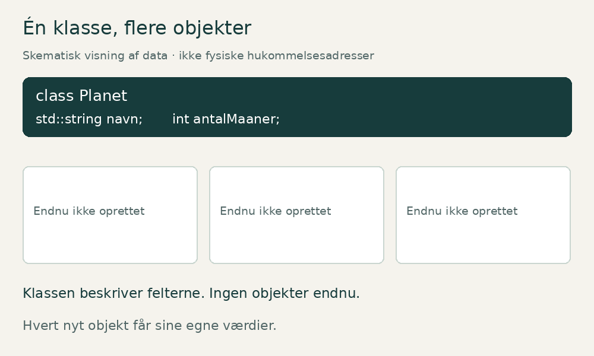
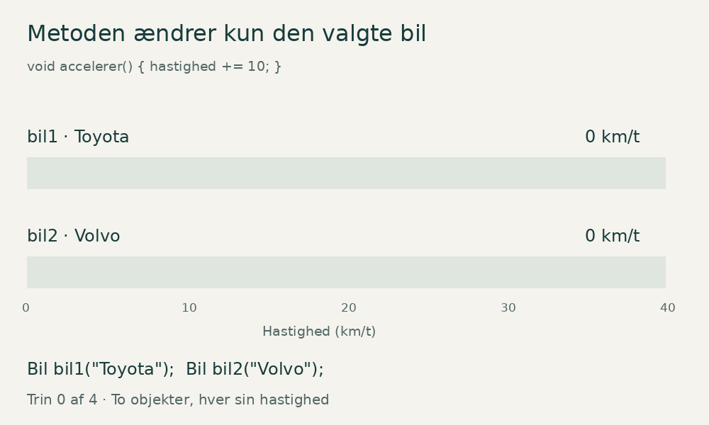

# Klasser og objekter i C++

*En begyndervenlig artikel med animerede illustrationer, programmer og øvelser.*

Når et program bliver større, har vi brug for at holde styr på ting, der både har oplysninger og kan udføre handlinger. En planet har eksempelvis et navn og et antal måner. En bil har en hastighed, og den kan accelerere. En studerende har en alder, som ændrer sig, når personen har fødselsdag.

I C++ kan vi samle sådanne oplysninger og handlinger i **klasser**. Når vi bruger en klasse til at skabe en konkret planet, bil eller studerende i programmet, får vi et **objekt**.

Artiklen begynder med planeter og bygger gradvist videre til constructors, metoder og adgangskontrol. Til sidst kan du afprøve forståelsen med opgaver og løsningsforslag.

> **Om de dynamiske billeder:** Illustrationerne er animerede GIF-filer. De viser ændringer over tid, men har ikke knapper som et interaktivt lab. Markdown kører normalt ikke interaktiv JavaScript-kode. Pak ZIP-filen ud, og behold mappen `assets` ved siden af denne artikel, så billederne kan vises i en Markdown-læser med GIF-understøttelse. Hvert billede har også en tekstlig forklaring.

## 1. Hvad er en klasse?

En klasse beskriver en type, som vi selv definerer. Du kender måske allerede de indbyggede typer `int` og `double`. Med `class` kan du definere en ny type som `Planet`.

Forestil dig et tomt skema med felterne navn, antal måner og afstand til Solen. Skemaets opbygning svarer til klassen. Et udfyldt skema for Mars svarer til et objekt.

En enkel klasse kan se sådan ud:

```cpp
class Planet
{
public:
    std::string navn;
    int antalMaaner = 0;
    double afstandTilSolen = 0.0;
};
```

`navn`, `antalMaaner` og `afstandTilSolen` er **medlemsvariabler**. De beskriver de data, hvert objekt har. `std::string` gemmer tekst, `int` gemmer et heltal, og `double` gemmer et decimaltal.

Startværdierne `0` og `0.0` gør de numeriske medlemmer veldefinerede, når vi opretter et objekt uden andre startværdier. En standardoprettet `std::string` er tom. Afstanden `0.0` er her en startværdi i programmet, ikke en oplysning om en virkelig planet.

Klassen slutter med `};`. Semikolonet efter klammen er nødvendigt i C++.

## 2. Hvad er et objekt?

Et objekt er en konkret instans af en type. Når vi skriver:

```cpp
Planet mars;
```

opretter vi et objekt med navnet `mars` og typen `Planet`. Derefter kan vi give det værdier:

```cpp
mars.navn = "Mars";
mars.antalMaaner = 2;
mars.afstandTilSolen = 227.9;
```

Punktummet betyder, at vi vælger et medlem i et bestemt objekt. `mars.navn` er derfor navnefeltet i objektet `mars`.

Der er forskel på `mars` og `"Mars"`. Det første er et navn, vi bruger i kildekoden. Det andet er en tekstværdi, som programmet gemmer i objektet. Vi kunne godt kalde objektet `planet1` og stadig gemme teksten `"Mars"` i det.

| Kode | Betydning |
| --- | --- |
| `Planet` | Klassen og typen |
| `mars` | Navnet på et bestemt objekt |
| `"Mars"` | En tekstværdi |
| `mars.antalMaaner` | En medlemsvariabel i objektet |
| `mars.visInfo()` | Et kald til objektets metode, når metoden er defineret |

## 3. Hvorfor er Planet en bedre klasse end Univers?

Merkur, Jorden og Mars **er planeter**. Derfor er `Planet` en passende fælles klasse for dem.

Universet **indeholder planeter**. Det er en anden relation. Hvis vi laver klassen `Univers`, vil et objekt af den klasse repræsentere et helt univers. Det kunne senere indeholde en samling af `Planet`-objekter.

Når du vælger klasser, hjælper spørgsmålet: »Hvilken slags ting er dette objekt?« Mars er en planet. En Toyota er en bil. Anna er en studerende. De svar giver os forslag til klasserne `Planet`, `Bil` og `Studerende`.

## 4. Samme klasse, forskellige data

Vi kan oprette mange objekter fra den samme klasse. De almindelige, ikke-statiske medlemsvariabler tilhører hvert sit objekt.



*Animationen er et skematisk billede af objekternes data, ikke et præcist kort over computerens hukommelse.*

Animationen viser først klassen, derefter objekterne `merkur`, `jorden` og `mars`. Til sidst ændres Mars' antal måner fra 2 til den **fiktive testværdi 5**. Merkur beholder 0, og Jorden beholder 1. Vi ændrer en model i et program, ikke den virkelige planet.

Det samme princip gælder denne kode:

```cpp
Planet jorden;
jorden.antalMaaner = 1;

Planet mars;
mars.antalMaaner = 2;
mars.antalMaaner = 5;
```

Efter den sidste linje er `jorden.antalMaaner` stadig `1`. Dette er en vigtig grund til at bruge objekter: Vi kan arbejde med én bestemt ting uden at blande dens data sammen med de andre tings data.

## 5. Metoder: funktioner, der tilhører klassen

En klasse kan også indeholde funktioner. De kaldes **medlemsfunktioner** eller **metoder**.

Metoden `visInfo()` kan læse et objekts data og udskrive dem:

```cpp
void visInfo() const
{
    std::cout << navn << " har "
              << antalMaaner << " maaner.\n";
}
```

Denne metode skal placeres inde i `Planet`-klassen i vores eksempel. Når vi skriver `mars.visInfo()`, bruger metoden værdierne i `mars`. Når vi skriver `jorden.visInfo()`, bruger den værdierne i `jorden`.

`void` betyder, at metoden ikke returnerer en værdi til den kode, der kalder den. Den udskriver tekst som sin handling.

## 6. Hvad betyder const?

`const` efter en medlemsfunktions parameterliste fortæller, at funktionen ikke må ændre objektets almindelige medlemsvariabler gennem dette kald. Det er nyttigt for metoder, der kun skal læse oplysninger.

```cpp
bool harMaaner() const
{
    return antalMaaner > 0;
}
```

Metoden returnerer enten `true` eller `false`. Har objektet værdien `2` i `antalMaaner`, bliver resultatet `true`. Har det værdien `0`, bliver resultatet `false`.

Et kald til `mars.harMaaner()` ændrer ikke antallet. Gentager vi kaldet, læser vi blot værdien igen. `const` gør ikke hele objektet permanent uforanderligt. Andre, ikke-const metoder kan stadig ændre det, hvis objektet tillader det.

> C++ har mere avancerede undtagelser, blandt andet medlemmer erklæret med `mutable`. De er ikke nødvendige i disse begynderøvelser.

## 7. Constructoren giver objektet en starttilstand

Det er besværligt at oprette et objekt og derefter udfylde alle felterne manuelt. En **constructor** gør det muligt at give startværdier, når objektet oprettes.

```cpp
Planet(std::string planetNavn, int maaner, double afstand)
    : navn(planetNavn),
      antalMaaner(maaner),
      afstandTilSolen(afstand)
{
}
```

Constructoren hedder det samme som klassen. Den har ingen returtype, heller ikke `void`.

Delen efter kolon er en **initialiseringsliste**. Her initialiserer `navn(planetNavn)` medlemmet `navn` med værdien fra parameteren `planetNavn`. De øvrige linjer gør det samme for de andre medlemmer. Medlemmer initialiseres i den rækkefølge, de er erklæret i klassen; vores liste følger samme rækkefølge.

Nu kan vi skrive:

```cpp
Planet mars("Mars", 2, 227.9);
```

Kaldet giver constructoren tre argumenter. Constructoren bruger dem til at oprette et objekt med en meningsfuld starttilstand.

| Argument | Parameter | Medlemsvariabel |
| --- | --- | --- |
| `"Mars"` | `planetNavn` | `navn` |
| `2` | `maaner` | `antalMaaner` |
| `227.9` | `afstand` | `afstandTilSolen` |

Når klassen kun har denne constructor med tre parametre, kan vi ikke længere skrive `Planet mars;`. Så skal vi enten give argumenterne eller også definere en constructor uden argumenter. Eksemplerne med manuel tildeling tidligere i artiklen brugte den første, enklere udgave af klassen.

## 8. Komplet program med planeter

Gem programmet som `planeter.cpp`. De angivne afstande er afrundede gennemsnitsværdier i millioner kilometer, ikke planeternes aktuelle afstande.

```cpp
#include <iostream>
#include <string>

class Planet
{
public:
    std::string navn;
    int antalMaaner;
    double afstandTilSolen;

    Planet(std::string planetNavn, int maaner, double afstand)
        : navn(planetNavn),
          antalMaaner(maaner),
          afstandTilSolen(afstand)
    {
    }

    void visInfo() const
    {
        std::cout << navn << " har " << antalMaaner
                  << " maaner og en gennemsnitlig afstand paa "
                  << afstandTilSolen << " millioner km.\n";
    }

    bool harMaaner() const
    {
        return antalMaaner > 0;
    }

    bool erTaetterePaaSolenEndJorden() const
    {
        return afstandTilSolen < 149.6;
    }
};

int main()
{
    Planet merkur("Merkur", 0, 57.9);
    Planet jorden("Jorden", 1, 149.6);
    Planet mars("Mars", 2, 227.9);

    merkur.visInfo();
    jorden.visInfo();
    mars.visInfo();

    std::cout << std::boolalpha;
    std::cout << "Mars har maaner: " << mars.harMaaner() << '\n';
    std::cout << "Merkur er taettere paa Solen end Jorden: "
              << merkur.erTaetterePaaSolenEndJorden() << '\n';

    return 0;
}
```

`#include <string>` giver adgang til `std::string`, og `#include <iostream>` giver blandt andet adgang til `std::cout`. Programmet starter i `main()`. `std::boolalpha` får boolske resultater til at blive vist som `true` og `false` i stedet for `1` og `0`.

Programmet udskriver:

```text
Merkur har 0 maaner og en gennemsnitlig afstand paa 57.9 millioner km.
Jorden har 1 maaner og en gennemsnitlig afstand paa 149.6 millioner km.
Mars har 2 maaner og en gennemsnitlig afstand paa 227.9 millioner km.
Mars har maaner: true
Merkur er taettere paa Solen end Jorden: true
```

Den enkle udskriftsmetode bruger samme ordform for alle antal. Det holder fokus på programmeringskonceptet.

## 9. public og private

I Planet-eksemplet er medlemmerne `public`. Det betyder, at kode uden for klassen kan tilgå dem direkte. Derfor kan vi skrive `mars.antalMaaner = 5;` i `main()`.

`private` begrænser denne direkte adgang. Klassens egne metoder kan stadig arbejde med de private medlemmer. I en `class` er medlemmer private som udgangspunkt, indtil en anden adgangsspecifikation står i koden.

Det er nyttigt, fordi klassen så kan kontrollere, hvordan dens tilstand ændres. En bil kan eksempelvis give adgang til `accelerer()` i stedet for at lade al kode skrive en vilkårlig hastighed direkte. Det kaldes **indkapsling**. Det er en regel i programmets opbygning, ikke kryptering eller beskyttelse mod alle mulige angreb.

## 10. Bil: en metode, der ændrer data

I næste program har hver bil sin egen private hastighed. Constructoren starter den på 0. Metoden `accelerer()` øger hastigheden med 10.



Animationen viser følgende rækkefølge:

| Trin | Kald | bil1 | bil2 |
| --- | --- | ---: | ---: |
| Start | Begge objekter oprettes | 0 km/t | 0 km/t |
| 1 | `bil1.accelerer()` | 10 km/t | 0 km/t |
| 2 | `bil1.accelerer()` | 20 km/t | 0 km/t |
| 3 | `bil2.accelerer()` | 20 km/t | 10 km/t |
| 4 | `bil1.accelerer()` | 30 km/t | 10 km/t |

Gem dette selvstændige program som `biler.cpp`:

```cpp
#include <iostream>
#include <string>

class Bil
{
private:
    std::string maerke;
    int hastighed;

public:
    Bil(std::string bilMaerke)
        : maerke(bilMaerke), hastighed(0)
    {
    }

    void accelerer()
    {
        hastighed += 10;
    }

    int hentHastighed() const
    {
        return hastighed;
    }

    void visInfo() const
    {
        std::cout << maerke << " koerer "
                  << hastighed << " km/t.\n";
    }
};

int main()
{
    Bil bil1("Toyota");
    Bil bil2("Volvo");

    bil1.accelerer();
    bil1.accelerer();
    bil2.accelerer();
    bil1.accelerer();

    bil1.visInfo();
    bil2.visInfo();
    return 0;
}
```

Output:

```text
Toyota koerer 30 km/t.
Volvo koerer 10 km/t.
```

`accelerer()` har ikke `const`, fordi den ændrer hastigheden. `hentHastighed()` og `visInfo()` læser kun data og kan derfor være `const`.

Prøver du at skrive `bil1.hastighed = 200;` i `main()`, giver compileren en adgangsfejl. Medlemmet er privat. Du må derimod kalde den offentlige metode `bil1.accelerer()`.

Modellen er bevidst enkel. Den simulerer ikke tid, friktion eller en virkelig bils acceleration.

## 11. Sådan afprøver du programmerne

Hvert komplet program har sin egen `main()`. Gem dem i hver sin fil, og byg dem hver for sig. Læg ikke alle tre `main()`-funktioner i samme program.

Hvis du har en C++-compiler som `g++`, kan du bygge det første eksempel med:

```bash
g++ -std=c++17 -Wall -Wextra -pedantic planeter.cpp -o planeter
```

På Linux, macOS eller WSL kører du derefter:

```bash
./planeter
```

I Windows med en tilgængelig `g++` kan du vælge `-o planeter.exe` og køre `./planeter.exe` i PowerShell. Bruger du Visual Studio, skal filen være en C++-fil med endelsen `.cpp` i et C++-projekt. En editor alene er ikke nødvendigvis en compiler.

Erstat `planeter.cpp` med `biler.cpp` eller `studerende.cpp`, når du arbejder med de andre eksempler.

## 12. Øvelser: forudsig, afprøv og forklar

En god øvelse har tre dele. Først forudsiger du resultatet. Derefter kører du programmet. Til sidst forklarer du, hvorfor resultatet blev sådan.

### Opgave 1: Klasse eller objekt?

Se på følgende kode:

```cpp
Planet planet1("Jorden", 1, 149.6);
Planet planet2("Mars", 2, 227.9);
```

Hvad hedder klassen? Hvad hedder objekterne? Hvad er forskellen på `planet1` og `"Jorden"`? Hvor mange gange bliver constructoren kaldt?

### Opgave 2: Opret Venus

Tilføj et objekt med navnet `venus`. Det skal have teksten `"Venus"`, 0 måner og afstanden 108.2. Kald `visInfo()`, og undersøg resultatet af `harMaaner()`.

### Opgave 3: Ændr kun Mars

Giv `mars.antalMaaner` den fiktive testværdi 5. Vis derefter oplysninger om både Mars og Jorden. Hvilken værdi forventer du for Jordens måner? Forklar, hvorfor den ikke ændres.

### Opgave 4: Gentagne læsninger

Kald `mars.harMaaner()` to gange. Kontroller antallet af måner før og efter. Forklar forskellen mellem at returnere et resultat og at ændre objektets tilstand.

### Opgave 5: To biler

Start med to nye biler. Få `bil1` til at ende på 30 km/t og `bil2` på 10 km/t ved kun at bruge `accelerer()`. Prøv derefter en ekstra acceleration på `bil2`. Hvilke hastigheder forventer du nu?

### Opgave 6: Din egen klasse

Lav klassen `Studerende` med navn, alder og uddannelse. Constructoren skal modtage startværdier til alle tre medlemmer. Lav en `visInfo()`-metode og en `harFoedselsdag()`-metode, som øger alderen med 1.

Opret Anna på 22 år og Ali på 24 år. Kald kun `anna.harFoedselsdag()`. Kontroller, at Anna bliver 23, mens Ali stadig er 24.

**Ekstra udfordring:** Gør alderen privat. Hvordan kan du lade `main()` læse alderen uden at give direkte skriveadgang?

## 13. Løsningsforslag

### Opgave 1

Klassen hedder `Planet`. Objekterne hedder `planet1` og `planet2`. `"Jorden"` er en tekstværdi inde i `planet1`. Constructoren bliver kaldt to gange, én gang ved hver oprettelse.

### Opgave 2

```cpp
Planet venus("Venus", 0, 108.2);
venus.visInfo();
std::cout << std::boolalpha << venus.harMaaner() << '\n';
```

Det sidste kald udskriver `false`, fordi antallet er 0.

### Opgave 3

```cpp
mars.antalMaaner = 5;
mars.visInfo();
jorden.visInfo();
```

Mars har nu testværdien 5, og Jorden har stadig 1. De to almindelige medlemsvariabler tilhører forskellige objekter.

### Opgave 4

```cpp
std::cout << mars.antalMaaner << '\n';
std::cout << std::boolalpha << mars.harMaaner() << '\n';
std::cout << mars.harMaaner() << '\n';
std::cout << mars.antalMaaner << '\n';
```

Med testværdien 5 får du `5`, `true`, `true`, `5`. Metoden returnerer et resultat uden at ændre antallet.

### Opgave 5

```cpp
bil1.accelerer();
bil1.accelerer();
bil1.accelerer();
bil2.accelerer();
```

Fra starttilstanden giver det 30 og 10 km/t. En ekstra acceleration på `bil2` giver 30 og 20 km/t.

### Opgave 6: Komplet løsning med private data

Gem programmet som `studerende.cpp`:

```cpp
#include <iostream>
#include <string>

class Studerende
{
private:
    std::string navn;
    int alder;
    std::string uddannelse;

public:
    Studerende(std::string n, int a, std::string u)
        : navn(n), alder(a), uddannelse(u)
    {
    }

    void harFoedselsdag()
    {
        ++alder;
    }

    int hentAlder() const
    {
        return alder;
    }

    void visInfo() const
    {
        std::cout << navn << ", " << alder
                  << " aar, " << uddannelse << '\n';
    }
};

int main()
{
    Studerende anna("Anna", 22, "IT");
    Studerende ali("Ali", 24, "IT");

    anna.harFoedselsdag();
    anna.visInfo();
    ali.visInfo();

    return 0;
}
```

Output:

```text
Anna, 23 aar, IT
Ali, 24 aar, IT
```

`hentAlder()` giver mulighed for at læse alderen. Den giver ikke adgang til at skrive direkte i det private medlem. Constructoren forudsætter i dette enkle eksempel, at den modtager en gyldig alder. Validering af eksempelvis negative aldre kan være en senere udvidelse.

## 14. Typiske begynderfejl

| Fejl | Hvorfor sker det? | Løsning |
| --- | --- | --- |
| Manglende `;` efter klassen | En klassedefinition kræver et afsluttende semikolon | Skriv `};` |
| `void Planet(...)` | En constructor må ikke have returtype | Skriv `Planet(...)` |
| `Planet mars;` efter tilføjelse af kun en constructor med parametre | Der findes ikke længere en passende constructor uden argumenter | Giv argumenterne, eller definér en constructor uden argumenter |
| Direkte adgang til et privat medlem | Adgangskontrollen afviser koden | Brug en offentlig metode |
| Ændring af almindelige medlemmer i en `const`-metode | Metoden lover ikke at ændre dem | Brug en metode uden `const`, når ændringen er meningen |
| Flere `main()`-funktioner i samme program | Eksemplerne er selvstændige programmer | Byg filerne hver for sig |
| Uinitialiserede tal i en tidligere udgave af klassen | Almindelige numeriske medlemmer får ikke altid automatisk en meningsfuld værdi | Brug medlemsinitialisering eller en constructor |

## 15. Hvorfor er klasser nyttige?

Klasser samler data og de funktioner, der arbejder med dem. Det gør det lettere at holde styr på mange forskellige objekter. Du kan bruge den samme klassedefinition til flere planeter, biler eller studerende uden at skrive en ny udgave af logikken for hvert objekt.

Når du senere bygger større programmer, kan private medlemmer og offentlige metoder gøre det tydeligt, hvilke ændringer et objekt tillader. Det hjælper dig med at organisere og teste koden. Klasser er dog et værktøj, ikke et krav om at gøre enhver lille variabel til et objekt af en ny klasse.

Du har forstået grundideen, når du kan forklare, hvorfor `anna.harFoedselsdag()` ændrer Annas alder, mens Alis alder bliver ved med at være den samme.
