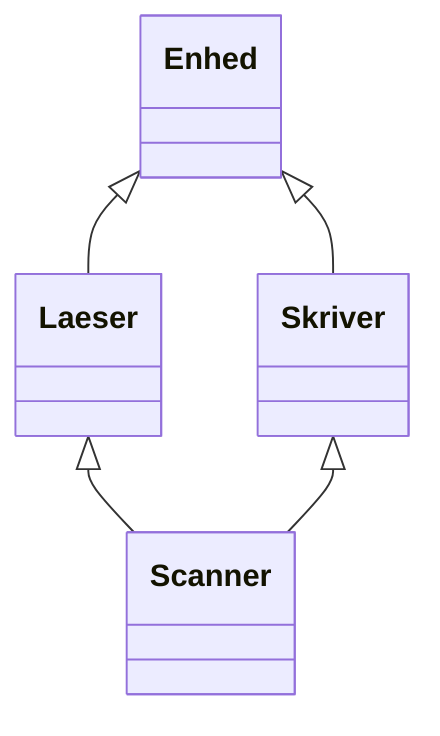

# Program 8 · Arv, klassehierarkier og objektets livscyklus

[Oversigt](OOP_Laeringsforloeb.md) · [Forrige](Program_7_Abstraktion_og_klassemedlemmer.md) · [Næste: Polymorfi](Program_9_Polymorfi_og_binding.md)

## Base class og derived class

Arv giver en klasse mulighed for at bygge på en anden klasse. Basisklassen beskriver en fælles del, mens den afledte klasse kan tilføje data og adfærd.

```cpp
class Sensor {
public:
    void start() { /* Fælles opstart */ }
};
class TemperaturSensor : public Sensor {
public:
    double temperatur() const { return 21.5; }
};
```

`TemperaturSensor` er en derived class, og `Sensor` er dens base class. Med offentlig arv kan et `TemperaturSensor`-objekt bruges som en `Sensor`, hvor adgang og entydighed tillader konverteringen. Den indeholder et Sensor-delobjekt; arv er ikke tekstlig kopiering af kildekoden.

Public arv bør udtrykke **er-en** i programmets betydning. En temperatursensor er en sensor. En robot **har** en sensor, så robotten bør normalt indeholde et sensor-medlem frem for at arve fra `Sensor`. Det sidste kaldes komposition.

Private data i basen findes stadig i base-delobjektet, men den afledte klasse kan ikke tilgå dem direkte. Brug basens grænseflade. `protected` kan give afledte klasser adgang, men kan også gøre dem stærkt afhængige af basens indre struktur.

| Arveform | Basens public-medlemmer bliver | Basens protected-medlemmer bliver |
| --- | --- | --- |
| `public Base` | public | protected |
| `protected Base` | protected | protected |
| `private Base` | private | private |

Basens private medlemmer bliver ikke direkte tilgængelige i nogen af disse tilfælde. I `class Derived : Base` er standarden privat arv; vi skriver derfor `public` eksplicit i eksemplerne.

## De forskellige hierarkier

| Form | Struktur | Eksempel på idé |
| --- | --- | --- |
| Single inheritance | Én direkte base | `TemperaturSensor : Sensor` |
| Multiple inheritance | Flere direkte baser | `Robot : Bevaegelig, Maalbar` |
| Multilevel inheritance | Flere led | `Sensor → TemperaturSensor → KalibreretSensor` |
| Hierarchical inheritance | Flere afledte deler en baseklasse | Temperatur- og tryksensor arver fra Sensor |
| Hybrid inheritance | En kombination af flere strukturer | En diamant med både flere led og flere baser |

“Hybrid” er en beskrivelse af diagrammet, ikke et særligt C++-nøgleord. Constructors fra basen bliver ikke automatisk kørt som en almindelig metode i derived-kroppen. Base-delobjekterne skal initialiseres, før derived-kroppen starter.

## Diamanten: én fælles base eller to?



En `Scanner` bygger her på både `Laeser` og `Skriver`. Begge bygger på `Enhed`. Ved almindelig arv har en Scanner derfor to Enhed-delobjekter, ét ad hver vej. Udtrykket `scanner.id` er tvetydigt, hvis begge delobjekter har `id`.

En kvalifikation som `scanner.Laeser::id` vælger den ene vej. Den fjerner tvetydigheden i det konkrete udtryk, men slår ikke de to delobjekter sammen.

Ved **virtual inheritance** kan de to veje dele ét base-delobjekt:

```cpp
struct Laeser : virtual Enhed { /* ... */ };
struct Skriver : virtual Enhed { /* ... */ };
```

Det er den mest afledte klasse, her `Scanner`, der initialiserer den fælles virtuelle base. `Laeser` skal stadig kunne initialisere Enhed, hvis en Laeser oprettes som et selvstændigt, mest afledt objekt. Når den indgår i en Scanner, bruges Scannerens initialisering af den virtuelle base i stedet.

`virtual` foran en baseklasse og `virtual` foran en medlemsfunktion løser forskellige problemer. Det første bestemmer delingen af base-delobjekter. Det andet bestemmer, hvilken funktion der kaldes ved polymorfi.

### Kør begge varianter

[04_diamant.cpp](examples/oop-advanced/04_diamant.cpp):

```cpp
#include <iostream>
namespace almindelig {
struct Enhed { int id; explicit Enhed(int i) : id(i) {} };
struct Laeser : Enhed { Laeser() : Enhed(1) {} };
struct Skriver : Enhed { Skriver() : Enhed(2) {} };
struct Scanner : Laeser, Skriver {};
}
namespace delt {
struct Enhed { int id; explicit Enhed(int i) : id(i) {} };
struct Laeser : virtual Enhed { Laeser() : Enhed(1) {} };
struct Skriver : virtual Enhed { Skriver() : Enhed(2) {} };
struct Scanner : Laeser, Skriver {
    Scanner() : Enhed(99), Laeser(), Skriver() {}
};
}
int main() {
    almindelig::Scanner a;
    // a.id er tvetydigt: der er to Enhed-delobjekter.
    std::cout << "Uden virtual: " << a.Laeser::id << ", " << a.Skriver::id << '\n';
    delt::Scanner b;
    b.Laeser::id = 42;
    std::cout << "Med virtual: " << b.id << ", " << b.Skriver::id << '\n';
}
```

Output:

```text
Uden virtual: 1, 2
Med virtual: 42, 42
```

I den virtuelle variant opretter Scanner først Enhed med `id = 99`. Derefter ændrer vi det fælles felt til 42 gennem Laeser-vejen. Skriver-vejen ser derfor også 42. Virtual inheritance løser ikke alle tænkelige navnekonflikter mellem Laeser og Skriver; to forskellige funktioner med samme navn kan stadig kræve et bevidst valg.

## Constructor- og destructor-rækkefølge

For et almindeligt, fuldt konstrueret derived-objekt kan du følge disse trin:

1. Virtuelle baser initialiseres først, i den rækkefølge arvehierarkiet bestemmer.
2. Direkte, ikke-virtuelle baser initialiseres i den rækkefølge, de står i base-listen.
3. Medlemmer initialiseres i deres erklæringsrækkefølge i klassen.
4. Constructorens krop kører.

Rækkefølgen på initialiseringslisten ændrer ikke punkt 2 og 3. Skriv listen i samme rækkefølge som erklæringerne for at undgå misforståelser.

Ved destruktion kører først den afledte destructors krop. Derefter destrueres medlemmerne baglæns, de direkte baser baglæns og til sidst de virtuelle baser. Det er en gradvis afvikling af det konstruerede objekt.

### Initialisering af basen fra derived-constructoren

```cpp
explicit Robot(int id)
    : BaseA(id), BaseB(), kamera("kamera"), motor("motor") {
    // Her er baser og medlemmer allerede initialiseret.
}
```

`BaseA(id)` giver argumentet videre til en base-constructor. Hvis BaseA ikke har en constructor uden argumenter, må derived-klassen vælge en passende constructor. At skrive `BaseA(id);` inde i kroppen ville skabe et andet, midlertidigt objekt, ikke initialisere Robot-objektets base-del.

[03_livscyklus.cpp](examples/oop-advanced/03_livscyklus.cpp):

```cpp
#include <iostream>
#include <string>
struct Spor {
    std::string navn;
    explicit Spor(std::string n) : navn(n) { std::cout << "+ " << navn << '\n'; }
    ~Spor() { std::cout << "- " << navn << '\n'; }
};
struct BaseA {
    explicit BaseA(int id) { std::cout << "+ BaseA " << id << '\n'; }
    ~BaseA() { std::cout << "- BaseA\n"; }
};
struct BaseB {
    BaseB() { std::cout << "+ BaseB\n"; }
    ~BaseB() { std::cout << "- BaseB\n"; }
};
struct Robot : BaseA, BaseB {
    Spor kamera;
    Spor motor;
    explicit Robot(int id) : BaseA(id), BaseB(), kamera("kamera"), motor("motor") {
        std::cout << "+ Robot-krop\n";
    }
    ~Robot() { std::cout << "- Robot-krop\n"; }
};
int main() { Robot r(7); }
```

Output:

```text
+ BaseA 7
+ BaseB
+ kamera
+ motor
+ Robot-krop
- Robot-krop
- motor
- kamera
- BaseB
- BaseA
```

Dette eksempel bruger ikke polymorf sletning gennem en basepointer. Hvis det var formålet, skulle basens destructor være egnet til det, typisk `virtual`, som forklaret i Program 9.

Hvis en constructor kaster en exception, destrueres de allerede færdigoprettede delobjekter. Den destructor, der tilhører det objekt, hvis constructor ikke blev færdig, bliver ikke kaldt. Program 11 viser dette med et konkret program.

## Opgaver

1. Tilføj et medlem `Spor mikrofon` efter `motor`. Hvor kommer det i begge spor?
2. Byt om på BaseA og BaseB i klassens base-liste. Hvad ændres?
3. Hvad bliver Scannerens fælles `id`, hvis `Enhed(99)` ændres til `Enhed(77)` og den senere tildeling fjernes?
4. Ville du modellere “Bil har en Motor” med arv eller med et medlem? Begrund dit valg.

<details><summary>Løsningsforslag</summary>

1. Mikrofonen oprettes efter motoren og før Robot-kroppen. Den destrueres efter Robot-kroppen og før motoren.
2. BaseB oprettes først, BaseA bagefter. Basernes destruktion følger den omvendte rækkefølge. Opdatér initialiseringslisten, så teksten følger den faktiske rækkefølge.
3. 77. Scanner er den mest afledte klasse og vælger den virtuelle bases startværdi.
4. Et medlem: `Motor motor;`. En bil er ikke en motor, men indeholder en.

</details>

## Videre læsning

[Multiple base classes og virtuelle baser](https://learn.microsoft.com/en-us/cpp/cpp/multiple-base-classes) og [destructors](https://learn.microsoft.com/en-us/cpp/cpp/destructors-cpp) hos Microsoft. Brug det interaktive labs diamant- og livscyklusforsøg til at følge delobjekterne trin for trin.
